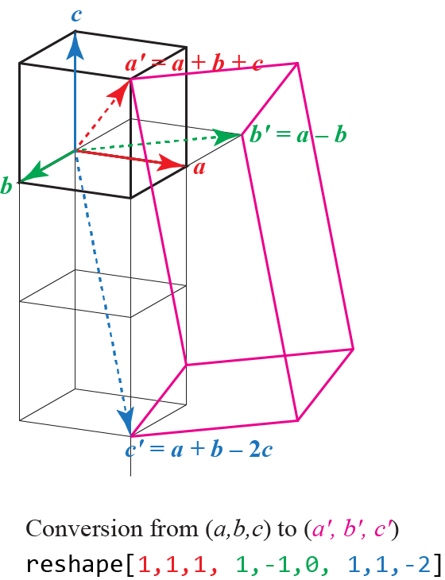

**Extending or transforming the unit cell**

## `replication_matrix` / `set_replication_matrix`

GenIce2’s `--reshape` (and GenIce3’s `set_replication_matrix`) redefines the
simulation cell by expressing new lattice vectors `(a', b', c')` as integer
linear combinations of the original `(a, b, c)`.

In the API the matrix is given **row-wise**, so each row is the coefficients of
one new vector. For example
`set_replication_matrix([[1,1,1],[1,-1,0],[1,1,-2]])` means:

- `a' = a + b + c`
- `b' = a − b`
- `c' = a + b − 2c`

which is the same as GenIce2 `--reshape 1,1,1,1,-1,0,1,1,-2`:

(Figure from the GenIce2 documentation set / wiki materials.)

A plain repetition such as `--rep 3 2 1` is the special case
`[[3,0,0],[0,2,0],[0,0,1]]`.

- `10_extend_unitcell.py`
  - Use `set_replication_matrix` to reshape the unit cell into a supercell, then
    export it as a standalone unitcell plugin (Python file) via the `python` exporter.
  - The sample uses `[[1, 1, 0], [-1, 1, 0], [0, 0, 1]]` (rotate/expand in the
    `ab` plane; `c` unchanged).

- `14_use_reshaped_unitcell.py`
  - Use `genice3.exporter.python.supercell_as_unitcell` to turn the current supercell
    into an in‑memory `UnitCell` object (no file output), then run `cage_survey` on the
    reshaped unit cell to analyse cage positions and types.
